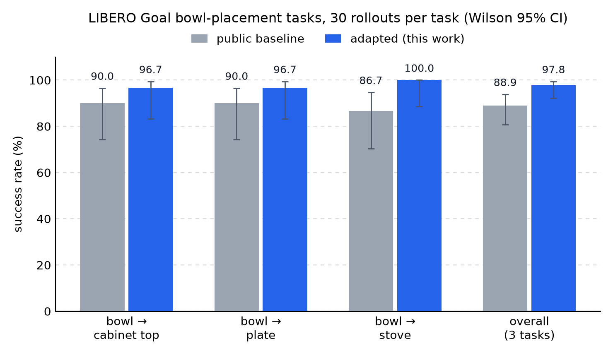
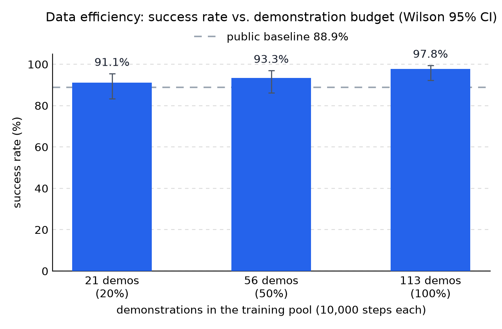
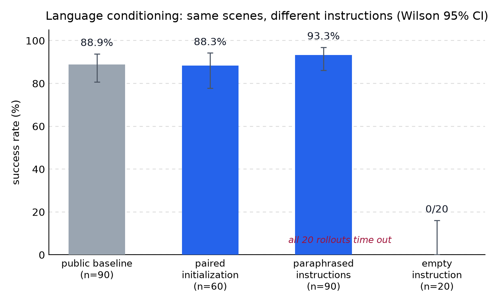

# SmolVLA 多任务适配与异步动作执行研究

> Supervised adaptation of SmolVLA on LIBERO manipulation tasks, with data-efficiency and
> language ablations, and an asynchronous action-chunk execution study — single RTX 3090.

在单张 RTX 3090 (24 GB) 上，从公开的 `smolvla_libero` checkpoint 出发，在 LIBERO Goal
三个语言条件放置任务（碗 → 盘子 / 炉灶 / 柜顶）上继续监督适配：113 条演示、10,000 步训练后，
同协议 90 回合评测成功率从 88.89% 提高到 **97.78%**（Wilson 95% CI [92.3%, 99.4%]）。
围绕这次适配搭了一条固定模型与数据 revision、按 episode 防泄漏的训练评测管线，并做了三组
对照实验：演示数据量的边际收益、策略对语言输入的依赖、以及推理迟到时动作块的异步执行。

## 结果

适配前后各任务的成功率（每任务 30 回合，误差棒为 Wilson 95% 置信区间）：



演示数量控制在 21 / 56 / 113 条（各自独立训练 10,000 步、完整评测 90 回合）时，成功率分别为
91.1% / 93.3% / 97.8%——20% 的演示已经能到 91%，但拉满数据仍有约 6.7 个百分点的差距：



语言消融在完全相同的场景下只改指令：三条训练时没见过的语义不变改写指令成功率 93.33%
（84/90）；把指令清空后 20 回合全部超时，说明策略确实在按语言执行而不是复述记忆的动作。
配对初始化评测把冻结的初始状态数组注入原生 BDDL，在初始状态精确一致的条件下比较语言输入，
成功率为 88.33%（53/60）：



## 异步动作执行

VLA 按动作块输出动作，推理一迟到就会动作断供；MuJoCo 渲染双相机也会拖死 50 ms 的控制周期。
这部分把控制与 GPU 推理拆成两个进程，把相机渲染挪到独立场景副本（与原场景逐像素一致），
控制周期中位数恢复到约 19.3 Hz，12 个固定验证回合全部满足「至少 95% 的周期 ≤ 55 ms」。
在此之上比较了四种迟到处理策略（3 任务 × 20 初始状态 × 4 方法 = 240 回合）：有限迟到的
RTC 接续把成功率从严格丢弃的 71.67% 拉回 83.33%（配对差 +11.67pp，95% CI [1.67, 21.67]），
但未超过 SHIFT 强基线的 95.00%。异步执行的配对演示视频：
[assets/demo_async_execution.mp4](assets/demo_async_execution.mp4)。

## 复现

管线要点：模型与数据固定到具体 commit；34.9 GB 的 LIBERO 数据按 Parquet footer 建立
episode ↔ shard 映射，只下载三个任务需要的 61 个 shard（5.90 GB，SHA-256 全量校验）；
143 episodes / 13,991 帧按 episode 切成互斥的训练 / 验证集（113 / 30），开发与最终评测切片
预注册、不参与调参。正式训练与评测只调用官方 `lerobot-train` / `lerobot-eval`，命令由
仓库内的生成器按冻结配置产出，历史命令存根保留在 `runs/`。

不装仿真环境也能验证安装与冻结协议：

```bash
cd sim_vla
python -m pip install -e ".[dev]"
python -m sim_vla.cli show-protocol
python -m sim_vla.cli check-environment --output runs/environment.json
```

安装仿真依赖后，按固定 revision 准备模型与资产并做 smoke：

```bash
python -m pip install -e ".[simulation,smolvla]"
MUJOCO_GL=egl python -m sim_vla.cli prepare-assets --kind all
MUJOCO_GL=egl python -m sim_vla.cli smoke-libero
MUJOCO_GL=egl python -m sim_vla.cli model-smoke
```

生成选择性数据清单并下载（61 shard，约 5.90 GB，SHA-256 全量校验）：

```bash
python -m sim_vla.cli build-data-manifest
python -m sim_vla.cli prepare-data \
  --root .cache/lerobot/libero-selected \
  --output runs/data_prepare.json
```

正式训练 / 评测命令由 `sim-vla-build-command` 按冻结配置生成，只调用官方
`lerobot-train` / `lerobot-eval`；历史命令存根见 `runs/*.command.txt`。

## 代码结构

- `src/sim_vla/` — 协议、清单、数据准备、评测统计与异步执行器
- `configs/`、`manifests/` — 冻结的实验配置、episode 级数据预算与初始化清单
- `scripts/` — 实验队列、审计与 README 图表生成（`build_readme_figures.py`）
- `results/` — 正式评测汇总（CSV / JSON / 图）；`assets/` — README 图表与演示视频
- 训练检查点、原始 rollout 视频、工程日志与项目文档未随仓库发布

## License

Apache-2.0（[LICENSE](LICENSE)）。构建于
[LeRobot](https://github.com/huggingface/lerobot)、SmolVLA 与
[LIBERO](https://github.com/Lifelong-Robot-Learning/LIBERO) 之上。
